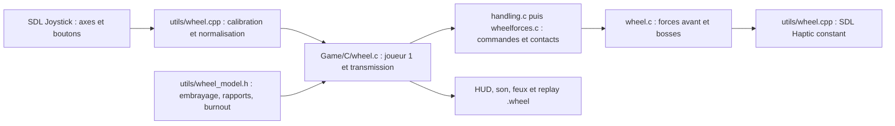

# Reprise technique et contexte — support sim racing

État documenté le 7 novembre 2026. Ce fichier vise un agent qui ne dispose pas de l'historique de conversation. Les références de code ci-dessous sont relatives à la racine du dépôt.

## Objectif utilisateur et périmètre

Adapter REDRIVER2 au Logitech G29, à son pédalier et à son shifter, avec frein à main USB indépendant. Priorités : direction et pédales analogiques, correspondance des butées du volant avec les roues en jeu, retour de force, embrayage et transmission manuelle simplifiés. Préparer les périphériques d'autres marques par des affectations configurables ; aucune certification de compatibilité de ces modèles n'a été faite.

Contraintes explicites : cinq rapports avant pour toutes les voitures, neutre et marche arrière sur la **position 6** du shifter (pas sa marche arrière physique dédiée). Le burnout Circle doit se déclencher en première à plein accélérateur, avec l'embrayage qui transmet le couple. Après les premiers essais, l'utilisateur a demandé de retrouver sa prolongation puis sa transition vers l'accélération X d'origine, ainsi que le frein à main Triangle à partir d'une fraction de la course USB.

Le modèle demandé s'inspire des comportements d'un simulateur, mais le moteur de Driver 2 reste arcade. Les valeurs physiques et la conversion en m/s sont des approximations à régler en conduite, pas des mesures constructeur.

## Dépôt, branches et points de reprise

| Référence | Contenu |
| --- | --- |
| `b2d88574` | Point de départ upstream OpenDriver2/REDRIVER2 |
| `572a16b8` | Première implémentation volant, transmission, FFB, calibration et replays |
| `a423d93e` — `wheel-controller` | Base des premiers essais : pédales corrigées sur le matériel, capture de diagnostic, démarrage depuis les images disque |
| `25483e6b` — `wheel-controller-drive-feel` | Corrections burnout, frein à main, propulsion en rapports élevés, FFB et compagnon replay v2 |

Ces deux branches ont été poussées vers `https://github.com/toukea/REDRIVER2.git` (remote local `fork`). `origin` pointe toujours vers `OpenDriver2/REDRIVER2`. La branche de corrections doit rester distincte de la base à la demande de l'utilisateur. Les commits documentaires suivants complètent cette chronologie.

Dans cette session, le dépôt de travail réel est `C:\Users\Istat\OneDrive\Documents\New project\REDRIVER2`. Le dossier affiché par un autre contexte de chat, `C:\Users\Istat\OneDrive\Documents\ChatGPT\Redriver2 modding`, était un dépôt vide : vérifier `git rev-parse --show-toplevel`, l'historique et les remotes avant d'agir.

## Ce qui est effectivement validé

- Windows détecte le G29 sous le nom `Logitech G HUB G29 Driving Force Racing Wheel USB` : quatre axes, 25 boutons, périphérique haptique disponible. Cela ne valide pas la qualité du couple ressenti.
- Les trois pédales ont été actionnées séparément par l'utilisateur pendant une capture des valeurs SDL brutes : accélérateur **A1**, frein **A2**, embrayage **A3**. Chacune atteint `32767` au repos et `-32768` enfoncée. Elles sont inversées lors de la normalisation. Le volant est A0.
- Un second périphérique USB, affiché `游戏手柄`, expose cinq axes et 24 boutons, sans haptique. Le profil enregistré pendant la session affecte son axe 3 au frein à main, via GUID. Conserver ce profil utilisateur ; la fidélité du déclenchement doit être retestée après les corrections.
- Les images fournies par l'utilisateur ont permis de démarrer réellement le jeu et de charger une voiture en `Take A Ride` à Chicago. Le HUD du nouveau mode affiche le rapport et le régime.
- L'utilisateur a réalisé un premier essai de conduite sur la base. Il a signalé : burnout trop court, frein à main différent de Triangle, rapports 3–5 trop faibles et ralentissant la voiture, FFB presque absent.
- La version `25483e6b` compile sous Windows et ses **75 contrôles** passent : 29 modèle, 24 pont jeu/replays, 22 SDL/configuration. Elle a été relancée et observée au menu. **Il n'y a pas encore de retour matériel confirmant que ces quatre corrections sont satisfaisantes.**

Les premiers comptes de 60 puis 62 tests correspondent aux étapes antérieures, pas à la couverture actuelle. Les captures brutes locales sont dans `src_rebuild/bin/tests/*.log`, ignorées par Git ; leur présence n'est pas garantie sur un autre poste.

## Architecture et flux des commandes



Le chemin volant n'est pas une émulation de boutons PlayStation. La direction manette existe déjà, mais elle est non linéaire et compressée par les replays. `Wheel_GameApply` remplace les commandes finales après le traitement original afin de conserver la précision des axes.

| Fichier | Rôle / raison de l'intégration |
| --- | --- |
| `src_rebuild/utils/wheel_model.h` | Mathématiques indépendantes de SDL : axes, `Input`, `Setup`, `Transmission`, `Output` |
| `src_rebuild/utils/wheel.h`, `wheel.cpp` | Ouverture des quatre groupes de périphériques, GUID, axes, boutons, hotplug, configuration, émission du FFB |
| `src_rebuild/utils/wheel_ui.cpp` | Fenêtre SDL autonome de calibration, police embarquée, liaison des axes/boutons et sauvegarde |
| `src_rebuild/Game/C/wheel.h`, `wheel.c` | État par voiture, application au joueur 1, collecte FFB, HUD, compagnon replay |
| `Game/C/pad.c` | Poll des périphériques et correspondance des boutons du volant avec les menus/manette |
| `Game/C/handling.c` | Réinitialisation à la création d'une voiture ; `Wheel_GameApply` à la fin de `ProcessCarPad` |
| `Game/C/wheelforces.c` | Branche physique dédiée aux voitures contrôlées au volant, frein de service séparé, verrouillage arrière, contacts avant pour le FFB |
| `Game/C/main.c` | `Wheel_GameFeedback` après `GlobalTimeStep` |
| `Game/C/gamesnd.c` | Régime sonore provenant du modèle volant au lieu du régime automatique historique |
| `Game/C/cars.c`, `overlay.c` | Feux de frein/recul, HUD rapport/régime/calage/refus de changement |
| `Game/C/replays.c`, `loadsave.c` | Réinitialisation, marqueur de replay, chargement/sauvegarde du compagnon et refus du mode carte mémoire |
| `src_rebuild/redriver2_psxpc.cpp` | Initialisation/arrêt, chargement du profil, démarrage autonome du calibrateur et recherche du dossier `data` |

Les chemins `Game/C/...` du tableau sont sous `src_rebuild`. Les `.c` du jeu sont compilés en **C++** par Premake. Les ajouts sont protégés par `#ifndef PSX` ; les structures historiques `CAR_DATA`/`HANDLING_DATA` n'ont pas été agrandies.

## Conventions et décisions de comportement

Entrées normalisées : direction `[-1,1]`, pédales/frein à main `[0,1]`, **embrayage 1 = pédale enfoncée, transmission déconnectée**. Rapport `-1 = R`, `0 = N`, `1..5` avant. Les groupes SDL sont volant, pédalier, shifter, frein à main ; les trois pédales doivent appartenir au même périphérique. À défaut d'affectation distincte, les groupes secondaires partagent le volant.

La plage physique `hardware_rotation` doit correspondre au pilote. `rotation` définit la plage de jeu ; `steering_lock` définit le braquage maximal des roues par côté. Les axes sont lus sur 16 bits, puis normalisés, et le braquage est converti en unités angulaires du jeu (`4096` par tour).

### Transmission

Pas de simulation : `1/30 s`. La vitesse utilisée par le modèle est `hd.wheel_speed / 4096 * .3`, conversion approximative. Le couple de départ est relié à `carCos->powerRatio` et à la propulsion native `4915`.

Le premier modèle multipliait cette propulsion par `ratio / ratioPremière` : en cinquième `.9/3.3`, soit environ 27 %, puis appliquait encore une courbe de couple. Cette double réduction expliquait le manque de propulsion. La révision conserve la propulsion native dans la plage utile des rapports 3–5 ; les rapports déterminent encore le régime, le sous-régime, le limiteur et le frein moteur. Ne pas réintroduire une réduction intégrale sans mesurer la vitesse de pointe face à une conduite native comparable.

La boîte refuse un changement manuel sans embrayage suffisamment enfoncé et protège l'engagement du sens opposé au-delà d'environ 1,5 m/s. Le mode assisté respecte aussi la pédale physique. Le calage et le redémarrage par débrayage/neutre plus accélérateur sont simplifiés.

### Burnout / frein à main

Le seuil natif de sortie du burnout est `452952` unités, environ `33.18 m/s` selon notre conversion. À première, accélérateur >97 % et embrayage suffisamment engagé, le mode Circle est maintenu jusqu'à ce seuil, puis passe à une propulsion X normale. Un état `burnoutFinished` empêche la réactivation lors d'une baisse de vitesse ; un relâchement sous 90 % ou un changement de rapport le réarme. Le limiteur synthétique de première est volontairement contourné pendant ce mode de lancement Driver : sinon il coupait la propulsion avant la transition demandée.

Le frein à main conserve sa valeur brute dans les données de replay mais son effet physique est binaire : activation à `handbrake_on=.30`, relâchement à `handbrake_off=.20` (hystérésis). Le verrouillage des roues arrière, la coupure de propulsion positive et la répartition d'adhérence reprennent les règles Triangle. Le frein de service applique séparément un effort longitudinal opposé au mouvement ; il ne sélectionne pas la marche arrière.

### Retour de force

Le signal combine les forces latérales des contacts avant, les variations de suspension et les surfaces. La révision passe la division du signal latéral de `16000` à `4000`, ajoute un rappel dépendant du braquage et de la vitesse **uniquement avec contact avant**, et conserve amortissement, filtrage et butées logicielles.

Paramètres initiaux de la révision : `ffb_gain=.60`, `ffb_filter=.55`, `ffb_road=.20`, `ffb_centering=.65`, `ffb_minimum=.08`. Le minimum compense la zone peu sensible du G29, avec un seuil évitant une force minimale appliquée au zéro exact. Vérifier ces valeurs sur le matériel ; ne pas les présenter comme une calibration définitive.

SDL doit proposer `SDL_HAPTIC_CONSTANT`. Un effet court de 120 ms est mis à jour/relancé à chaque commande. Les forces sont arrêtées hors conduite, à la perte de focus, à la pause et en replay ; la disparition d'une mise à jour laisse expirer l'effet. Les erreurs d'envoi sont journalisées une fois. Le jeu demande le gain haptique matériel à 100 % lorsqu'il est pris en charge, puis applique son gain logiciel. Les chocs de carrosserie n'ont pas de signal spécifique.

## Replays : contrat de données

Le replay natif porte `WHEEL_REPLAY_MAGIC = 0x574c5250` lorsqu'un compagnon est nécessaire. Le compagnon s'appelle `<nomReplay>.wheel`. Son en-tête contient cinq `uint32_t` : magic `0x314c4857`, version **2**, FNV-1a 32 bits du fichier de base, nombre de frames, taille d'une frame. La somme associe le compagnon au fichier de base ; ce n'est pas une protection cryptographique du compagnon.

Une frame fait 28 octets : `int32 frame, car`, puis `int16 steer, thrust, rpm, gear`, puis `uint16 throttle, brake, clutch, handbrake, flags, reserved`. Bits de flags : 1 actif, 2 burnout, 4 calé, 8 changement refusé, 16 frein à main enclenché. Le régime stocké est ramené à l'échelle sonore du jeu, pas directement en tr/min.

Les sorties finales sont enregistrées par `CameraCnt`, pour éviter la quantification native sur 16 positions de direction et permettre la lecture sans périphérique ni réglages identiques. Limite : 216000 frames, deux heures à 30 Hz. Le format utilise le layout binaire vérifié par `static_assert`, pensé pour Windows little-endian ; ce n'est pas encore un format portable indépendant de l'architecture.

La version 1 est refusée sur cette branche car le calcul physique a changé. La base `wheel-controller` permet de reprendre ces anciens compagnons. Les replays natifs restent acceptés et ignorent un compagnon périmé. Un compagnon requis absent, tronqué, incohérent ou associé à un autre fichier est refusé. Les replays carte mémoire ne prennent pas en charge ce mode. Toute modification de physique doit considérer la compatibilité de ces sorties et la version du compagnon.

## Compilation, exécution et diagnostics

```powershell
# À exécuter depuis la racine réelle du dépôt
git submodule update --init --recursive
./build-wheel.ps1 -TestsOnly
./build-wheel.ps1
./src_rebuild/bin/tests/wheel_runtime_tests.exe --devices
./src_rebuild/bin/tests/wheel_runtime_tests.exe --monitor 45
```

Visual Studio 2022 avec outils C++ et SDK Windows est requis. Le script trouve Visual Studio via `vswhere`, télécharge SDL2 2.30.2, OpenAL Soft 1.23.1, JPEG 9d et Premake beta1 si manquants. Le jeu est produit en **Win32** (le code historique contient des conversions pointeur/entier risquées en x64), les exécutables de test en x64. Des avertissements upstream subsistent ; une compilation réussie n'implique pas leur résolution.

La compilation complète applique `patches/psycross-wheel.patch` dans le sous-module upstream `e56e4cde1c2b8a15e0d4e38b26cdd9202e0d17e6`. Ce correctif retire la réinitialisation globale des haptiques lors du hotplug et empêche l'envoi de rumble manette à un volant. Le gitlink upstream reste inchangé. Un `m src_rebuild/PsyCross` après compilation est donc attendu. Le mode `-TestsOnly` ne remplace pas cette application ni la compilation du jeu.

Sorties : `src_rebuild/bin/Release/REDRIVER2.exe`, `WheelConfig.exe` et DLL voisines. `WheelConfig.exe` est une copie du même programme dont le nom déclenche le mode configuration ; `REDRIVER2.exe -wheel-config` fait de même. Les lanceurs `calibrate-wheel.cmd` et `start-wheel-game.cmd` établissent le dossier de travail `data`. L'ouverture directe de l'exécutable recherche aussi `../../../data/config.ini` si nécessaire.

`--devices` énumère les périphériques ; `--monitor N` capture les axes/boutons bruts pendant 1–120 secondes sans ouvrir ni envoyer d'effet de force. Demander les mouvements physiques après démarrage de la capture, un périphérique ou une pédale à la fois. La première capture de 45 secondes avait expiré avant les mouvements de l'utilisateur : ne pas conclure à une panne d'après une capture manquée.

Le calibrateur doit avoir le focus pour ses raccourcis. Les frappes de lettres injectées par l'automatisation Windows n'ont pas toujours été reçues par SDL pendant cette session ; demander à l'utilisateur d'appuyer sur les touches ou vérifier visuellement le statut avant de considérer une calibration active. Les premières lectures SDL peuvent également être à zéro brut, donc à mi-course normalisée pour les pédales, avant un événement réel du périphérique. Ne pas enregistrer ces valeurs comme une calibration de repos ni confondre cet état avec une mauvaise affectation.

Les tests couvrent les axes, la configuration et le cycle SDL virtuel ; les changements de rapport, l'embrayage, le calage, le burnout et la propulsion haute ; le pont jeu, les seuils du frein à main, les commandes FFB et les compagnons replay. Ils **ne mesurent pas** la vitesse de pointe réelle, le couple ressenti, l'adhérence en virage ni le passage de disque.

## Données locales et travail à préserver

Les archives originales sont dans `C:\Users\Istat\Games\Driver2\ROM`, sous les noms `Driver 2 (Disc 1) (v1.1).7z` et disque 2 équivalent. Seuls BIN/CUE ont été extraits vers `data/install/disc1/` et `disc2/`. `data/config.ini` référence le BIN du disque 1. Le CUE indique MODE2/2352. La lecture directe par PsyCross a suffi au chargement de Chicago ; il n'a pas fallu importer de ROM dans les sources ni convertir le contenu pour cet essai.

Ne pas commiter les images, les archives, les fichiers de sauvegarde ou les logs. `data/wheel.ini` est suivi et peut être modifié par l'utilisateur via le calibrateur ; examiner ses différences avant de reconstruire un profil. `data/wheel.ini.bak` est une sauvegarde locale. `VR_OPENXR_ANALYSE.md` existait avant ce travail de documentation et relève d'un autre chantier : ne pas l'inclure sans demande.

## Prochaines vérifications utiles

1. Comparer la même voiture de Chicago sur la base puis sur la branche de corrections : départ en première, durée du burnout, transition vers accélération normale, accélération en 3/4/5 et vitesse de pointe sur un trajet comparable.
2. Vérifier le frein à main USB près des seuils 30/20 %, le verrouillage arrière et le retour à l'adhérence, sans confondre avec le frein de service.
3. Confirmer le sens du FFB et son intensité, le comportement en contre-braquage, à l'arrêt, en l'air, dans les menus, à la perte de focus et après déconnexion. Le rappeler avant chaque hausse d'intensité ; ne pas annoncer une validation sans retour physique.
4. Comparer une conduite enregistrée et sa lecture v2. Vérifier aussi les replays natifs, le clavier/manette et le personnage à pied.
5. Vérifier les villes du disque 2 et leur chargement : la simple extraction du disque 2 ne prouve pas que la commutation est gérée.

Mettre à jour ce document après des mesures ou décisions nouvelles, en distinguant observation, réglage expérimental et résultat confirmé.
